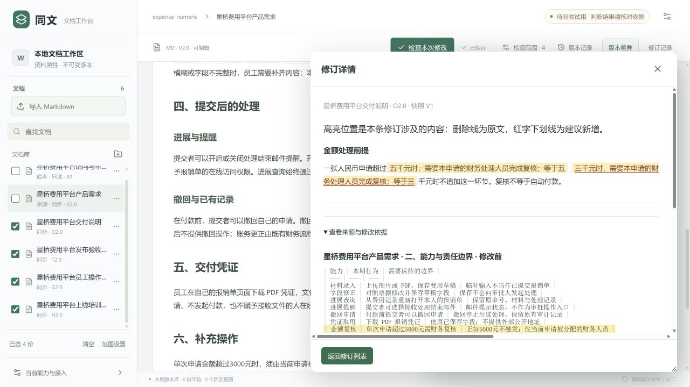

# 同文 · 文档变更核对 Agent

修改一份需求后，找出其他资料中需要跟着修改的内容，查看依据，再由你确认保存。

同文是个人使用的本机文档工作台。它将来源改动、关联调查、修订建议和版本记录放在同一流程中，帮助维护需求、交付说明、验收计划与操作指南之间的一致性。

[快速开始](docs/快速开始.md) · [样例与操作](docs/样例与操作.md) · [Agent 工作原理](docs/Agent工作原理.md) · [验证与边界](docs/验证与边界.md)


## 从一处修改开始

当前样例是一组费用平台资料，共六份 Markdown 文档，包含章节、表格、列表和不同用途的说明。

1. 打开产品需求，将金额门槛从 5000 元改为 3000 元。
2. 勾选交付说明、发布验收、员工指引与培训重点，检查本次修改。
3. 查看建议中的修改前后文本及来源依据，确认需要保存的条目。
4. 刷新核对结果；需要恢复时，从修订记录撤销对应批次。

这个案例曾完成一次真实模型与界面闭环：三份目标按需修改，底本和精选培训资料保持，保存、刷新与撤销均通过。完整结果与验证范围见[验证与边界](docs/验证与边界.md)。



## 本机运行

需要 Node.js 24。

```powershell
git clone https://github.com/julie-L0/TongWen.git
cd TongWen
npm install --omit=dev --ignore-scripts
npm start
```

打开 <http://127.0.0.1:3010/>。首次启动创建合成样例，后续启动保留编辑和记录。使用真实模型检查前，需要自行配置模型 API key，具体步骤见[快速开始](docs/快速开始.md)。

## 已实现的能力

| 能力 | 使用方式 |
| --- | --- |
| 文档组织 | Markdown 导入、文件夹、名称整理与勾选目标 |
| 来源与约束 | 比较来源改前／改后，结合底本和所选资料调查 |
| Agent 检查 | 模型逐轮选择工具，读取证据、判断关系、提出局部修订 |
| 人工确认 | 展开差异与依据，逐条或分批确认；支持保留与稍后处理 |
| 版本恢复 | 保存回读、历史查看、批次撤销及过期建议保护 |
| 检查窗口 | ×关闭、“收起”最小化；记录可重新打开 |

## 关系复用实验

[已确认段落关系复用](https://github.com/julie-L0/TongWen/tree/codex/confirmed-relation-demo)位于独立分支，使用两篇单段资料，验证首次发现关系、人工确认和下一次修改时的局部复核。它与默认六文档样例分别维护，性能结果只适用于该限定实验。

## 阅读源码

| 目录 | 内容 |
| --- | --- |
| `src/` | React 工作台、编辑器、差异与修订窗口 |
| `server/agent/` | 模型工具循环、证据、调查及确认保护 |
| `server/application/` | 文档、组织、版本与应用接口 |
| `server/infrastructure/` | 模型适配与 SQLite 持久化 |
| `shared/` | 前后端共享契约 |
| `examples/` | 合成业务资料 |
| `docs/` | 使用说明、验证记录与历史归档 |

当前是个人原型。正常样例的单次通过不代表任意资料的稳定正确率；PDF 与澄清续跑尚未完成完整验收。仓库中的截图保留其原验证版本，最新界面修复另有记录。
