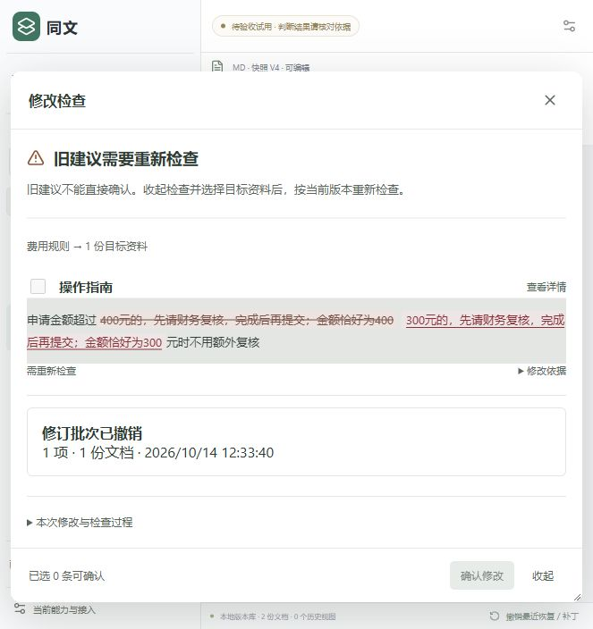

# 同文 · 已确认段落关系复用

首次修改由 Agent 调查关联；用户确认保存后，下一次修改沿已确认关系定位，再用新的模型结果核对。

这是同文的独立关系复用实验分支，使用两篇单段合成资料。[主工作台](https://github.com/julie-L0/TongWen)提供六文档金额样例，两种验证分别维护。

[快速开始](docs/快速开始.md) · [验证与边界](docs/验证与边界.md) · [文档索引](docs/README.md)

## 一条可复现的流程

1. 首次将“费用规则”中的300改为400，选择“操作指南”并检查。
2. 查看真实模型建议并确认保存，后台记录关系和400版本检查点。
3. 重启后将来源400改回300，再次检查，核对并保存本次建议。
4. 刷新回读，或从修订记录撤销对应批次。

第二次检查使用上次确认的400检查点，不会因为数值回到首次导入的300而忽略变化。旧关系帮助定位，本次结论和补丁仍由新的模型请求产生。


## 本机运行

需要 Node.js 24。建议使用独立目录，以保留各自的资料库。

```powershell
git clone --branch codex/confirmed-relation-demo https://github.com/julie-L0/TongWen.git TongWen-relations
cd TongWen-relations
npm install --ignore-scripts
npm start
```

打开 <http://127.0.0.1:3084/>。首次启动建立两篇单段资料，初始300元，零历史任务和关系缓存。使用真实模型前，自行配置模型 API key，步骤见[快速开始](docs/快速开始.md)。

## 单次同输入对照

| 路径 | 模型请求 | 总 token | 耗时 |
| --- | ---: | ---: | ---: |
| 首次发现300→400 | 6 | 45,519 | 15.901秒 |
| 确认后复用400→300 | 1 | 1,902 | 4.812秒 |
| 相同输入冷对照400→300 | 7 | 54,037 | 18.242秒 |

本次热／冷对照观察到耗时减少73.6%、总token减少96.5%。这是一对段落的一次实验，不能外推为所有文档的稳定收益。[原始结果](docs/verification/relation-results.json)保留真实用量与核对范围。

## 实现与边界

确认合并后，SQLite保存来源和目标的稳定端点、关系类型与版本检查点。下一次修改先校验资料身份、版本与上下文，再进行本次语义复核。关系失效或条件不满足时转回完整调查。

快速路径仅覆盖两篇单段同步文档的数值变化。额外正文、底本、历史、非数值变化或目标独立修改均不能直接沿用这个加速结果。证据、来源条件、整文复核、人工确认、事务保存和撤销保护继续保留。



| 位置 | 职责 |
| --- | --- |
| `server/agent/confirmed-relations.ts` | 保存、校验和失效已确认关系 |
| `server/agent/confirmed-check.ts` | 新模型复核及原保护工具提交 |
| `server/agent/service.ts` | 选择有效关系与来源检查点 |
| `tests/confirmed-relations.test.ts` | 离线协议测试 |

离线测试使用 `npm run test:relations`，前端重建使用 `npm run build:ui`。真实运行结果、工程检查和验证限制见[验证与边界](docs/验证与边界.md)。
