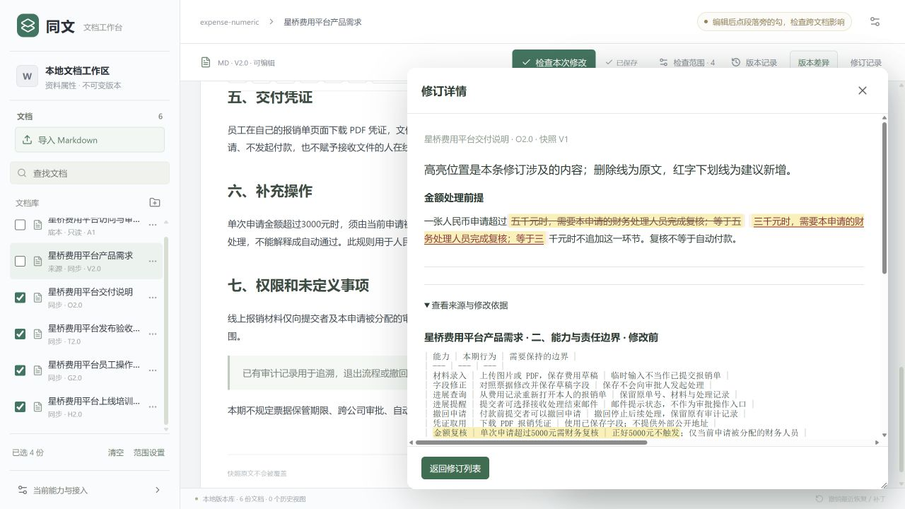
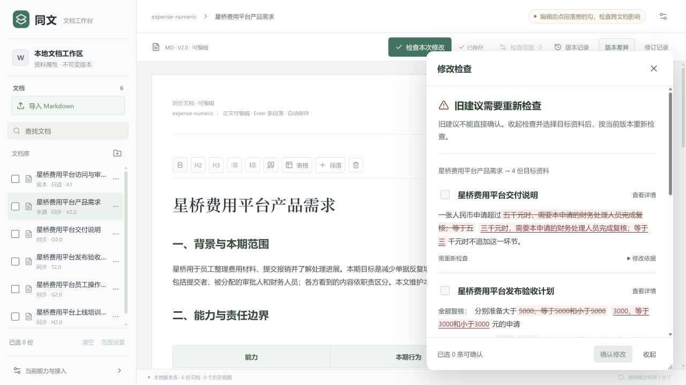

# 同文 · 跨文档变更工作台

**改了一处需求，相关说明、验收与操作指引还需要同步哪里？** 同文将来源修改、检查范围、依据和建议放在同一个工作台，帮助使用者逐条核对并确认修改，保存后仍可查看版本与撤销。

此链接是可直接阅读的成果展示与源码入口。运行原型需要下载 ZIP 在本机启动。

## 一条核心流程

编辑来源文档 → 选择同组目标资料 → 检查跨文档影响 → 对照原文和底本核对建议 → 分批确认 → 刷新检查全文 → 必要时撤销。

报销与识别材料都是用于验证的合成文档；它们不是同文自身的业务功能。

## 真实演示证据

### 查看依据，再确认

历史 **0.26.15** 金额规则场景：把来源的 5000 元门槛改为 3000 元后，真实模型给交付说明、发布验收和员工指引提出必要修改；培训重点保持原文。下图展示交付说明的修改前后与来源依据。

### 保存、刷新与撤销

同一轮真实界面验证逐份确认三批修改，刷新后完整读取六份文档，再逐份撤销并再次刷新。共 **48 项检查通过**：来源编辑保留、底本与无关内容保持、三批修改撤销、旧建议禁用。模型耗时约 42 秒，22 次模型请求。[查看该版本验证记录](docs/historical-02615-normal-proof.json)。

以上截图与结果仅证明 0.26.15 的金额规则流程；不能用于宣称当前候选已全场景通过。

## 当前交付边界

| 项目 | 实际状态 |
| --- | --- |
| 首版 0.26.23 ZIP | 新目录解压、启动、编辑、自动保存、刷新与底本只读已验证；真实模型语义仍有已知错误建议 |
| 备用 0.26.15 ZIP | 历史金额规则流程 48 项通过；冲突判断仍有已知失败 |
| 两组演示资料 | 共 10 份纯合成文档；不含历史模型结果 |
| 真实模型检查 | 需自行配置 API key；没有 key 时可编辑保存，不进行模型检查 |
| 在线访问 | 本仓库提供展示和下载；本地应用尚无公网运行入口 |

## 下载与源码

- [首版试用 ZIP · 0.26.23](releases/tongwen-demo-initial-02623.zip)：自带运行依赖与合成资料，尚未全验收通过。
- [备用 ZIP · 0.26.15](releases/tongwen-demo-backup-02615.zip)：用于复现已验证的金额规则流程，冲突仍有已知失败。
- 本仓库包含 React 界面、Node Agent、SQLite 版本库和初始化脚本。[解压启动验证](docs/clean-start-proof.json) · [重新下载核对](docs/download-verification.json)。

## 最快启动

1. 安装 Node.js 24（本地验证版本24.14）。把ZIP全部解压到较短的本地目录。
2. Windows双击“启动演示.cmd”。终端保持打开，浏览器地址为 http://127.0.0.1:3010/ 。关闭终端或Ctrl+C停止服务。
3. macOS/Linux或终端用户：在解压目录执行 node scripts/start-demo.mjs 。

ZIP自带已审查的纯JavaScript运行依赖，不必先联网装包。GitHub源码下载若没有node_modules，先执行 npm install --omit=dev，再执行 npm start。首次启动只建立新的合成资料库，之后重新启动保留自己的编辑；不会替换日常工作区。

## 真实模型检查

需要自行配置模型 API key。把 .env.example 复制为 .env，按示例填写自己的 API key。密钥只由本机后端使用，不写入前端，也不随运行包提供。未配置时可以浏览、编辑、保存和查看版本；启用真实检查后，调用使用自己的 API 额度。

## 两个操作示例

- 金额规则：打开“星桥费用平台产品需求”，把已有金额表格与规则段中的5000改为3000；选择同组交付说明、发布验收、员工指引和培训重点，再检查。先读每条修改与依据，仅对确实正确的建议分别确认；刷新全文，使用每个修订批次的撤销按钮逐份撤销，检查来源修改仍保留。
- 底本冲突：打开“个人智能识别使用说明”，在最后一段删除“没有”和“不要”；只选择同组发布验收和产品亮点，检查这段。底本必须保持只读，遇到冲突或未定义事项应保留目标原文；不要确认虚构的协作、清理或留存步骤。

## 代码与重建

src为React界面，server为Node Agent／工具循环／门禁与SQLite实现，shared为接口类型，scripts为本包启动与合成资料初始化。dist-v2是对应已构建页面。若要重建界面，可把package.source.json另存为package.json，再安装开发依赖并运行 npm run build:ui。

本包不含真实用户库、旧私人正文、评分答案、模型历史消息、任何认证信息或模型key。submission-version.json与文件指纹说明本包身份；新的示例库不包含旧保存结果，不以回放冒充真实调查。

