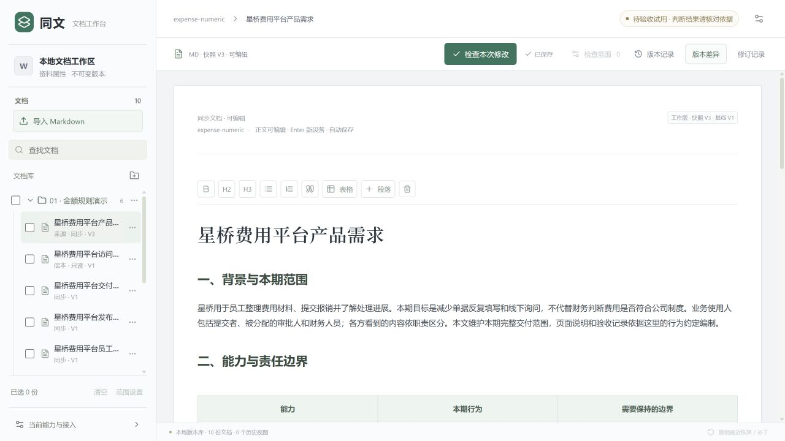

# 同文 · 跨文档变更工作台

这是可以本地运行的源码工程，包含预构建页面与两组纯合成资料。不是在线免安装网址。

当前版本：semantic-agent-0.26.23-candidate。当前候选仍在修复验证，真实检查曾漏冲突并编造建议；请核对原文和依据，不将检查完成当成业务正确。

下载：[当前试用ZIP](releases/tongwen-demo-initial-02623.zip) · [0.26.15备用ZIP](releases/tongwen-demo-backup-02615.zip)。备用版金额规则曾通过真实界面保存、刷新、撤销48项检查，但冲突场景未通过；两版不能合并称为全验收通过。

## 最快启动

1. 安装 Node.js 24（本地验证版本24.14）。把ZIP全部解压到较短的本地目录。
2. Windows双击“启动演示.cmd”。终端保持打开，浏览器地址为 http://127.0.0.1:3010/ 。关闭终端或Ctrl+C停止服务。
3. macOS/Linux或终端用户：在解压目录执行 node scripts/start-demo.mjs 。

ZIP自带已审查的纯JavaScript运行依赖，不必先联网装包。GitHub源码下载若没有node_modules，先执行 npm install --omit=dev，再执行 npm start。首次启动只建立新的合成资料库，之后重新启动保留自己的编辑；不会替换日常工作区。

## 真实模型检查

没有配置模型key时，可以浏览、编辑、保存和查看版本；检查不会假装调用模型。要启用真实检查，在自己电脑把.env.example复制为.env，填写自己的DEEPSEEK_API_KEY。key只由本机后端使用，不写入前端，不随此包提供。调用会使用官方api.deepseek.com并消耗自己的额度。当前模型固定为deepseek-v4-pro，每轮最多40次请求。

## 两个操作示例

- 金额规则：打开“星桥费用平台产品需求”，把已有金额表格与规则段中的5000改为3000；选择同组交付说明、发布验收、员工指引和培训重点，再检查。先读每条修改与依据，仅对确实正确的建议分别确认；刷新全文，使用每个修订批次的撤销按钮逐份撤销，检查来源修改仍保留。
- 底本冲突：打开“个人智能识别使用说明”，在最后一段删除“没有”和“不要”；只选择同组发布验收和产品亮点，检查这段。底本必须保持只读，遇到冲突或未定义事项应保留目标原文；不要确认虚构的协作、清理或留存步骤。

## 代码与重建

src为React界面，server为Node Agent／工具循环／门禁与SQLite实现，shared为接口类型，scripts为本包启动与合成资料初始化。dist-v2是对应已构建页面。若要重建界面，可把package.source.json另存为package.json，再安装开发依赖并运行 npm run build:ui。

本包不含真实用户库、旧私人正文、评分答案、模型历史消息、任何认证信息或模型key。submission-version.json与文件指纹说明本包身份；新的示例库不包含旧保存结果，不以回放冒充真实调查。

## 已验证与限制

首版 ZIP 已在新目录解压启动，并通过真实界面编辑、自动保存、刷新和只读底本检查；没有 key 时模型调用为 0。截图见下方。当前 Agent 业务判断仍有已知失败，尚未全验收通过。文件指纹：SOURCE_MANIFEST.json 为本仓库，ZIP_INITIAL_MANIFEST.json 仅适用于首版 ZIP 内文件。

