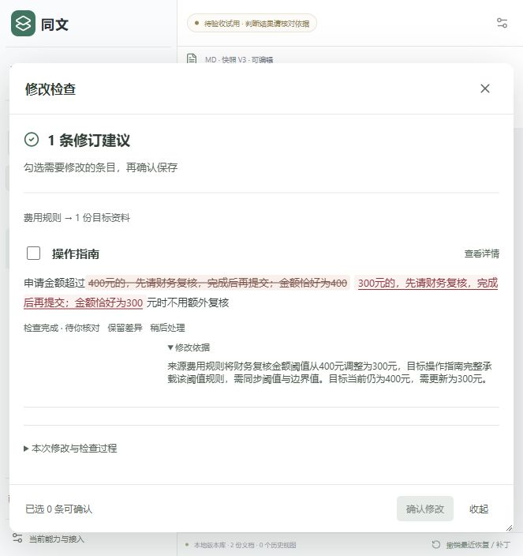

# 同文 · 已确认段落关系复用小样

这是本人使用的个人文档原型，独立分支 `codex/confirmed-relation-demo`。[默认金额工作台](https://github.com/julie-L0/TongWen)保持独立。

第一次修改来源时，AI发现两段文档的关系，用户通过已有“确认修改”保存后，后台记录关系及版本检查点。下次修改时自动先检查这条已确认关系，再调用真实AI核对本次变化并提出局部修订。界面沿用原来的检查、确认、版本与撤销操作。

## 本机启动

安装Node.js 24，克隆本仓库并切到本分支，在目录执行 `npm install --ignore-scripts`，再执行 `npm start`。打开 http://127.0.0.1:3084/ 。新库只初始化“费用规则”和“操作指南”两篇单段合成资料，初始300元，零任务、零关系缓存。

需要使用模型检查时，将 `.env.example` 复制为 `.env`，自行配置模型 API key。没有key可以编辑和查看版本；不会发出模型请求。每个分支/目录使用自己的runtime，不替换日常工作区。

[全新源码启动核对](docs/fresh-source-start-proof.json)。

## 操作流程

来源300→400，选择操作指南并检查，核对建议后确认。确认后关系与400检查点在后台保存。重启服务、刷新，再把来源400→300，用已有工具栏“检查本次修改”；后台以已确认的400检查点比较，而不是只与首次导入的300比较。继续核对真实AI建议，确认、刷新回读和撤销。

## 一次真实对照结果

| 路径 | 模型请求 | 输入token | 输出token | 检查耗时 |
| --- | ---: | ---: | ---: | ---: |
| 首次发现300→400 | 6 | 44,482 | 1,037 | 15.901秒 |
| 已确认关系复用400→300 | 1 | 1,355 | 547 | 4.812秒 |
| 相同输入冷对照400→300 | 7 | 52,861 | 1,176 | 18.242秒 |

本次同输入对照观察到耗时减少73.6%、总token减少96.5%；仅一次两段资料实验，不能外推为所有文档稳定收益。原作者的三任务真实确认用量与20项核对见 [结果记录](docs/confirmed-relation-demo-results.json)。本次源码发布只做安装、构建、离线测试与新库启动检查，没有追加模型任务。

## 范围与代码

自动复用仅适用两篇单段同步文档的数值变化。额外正文、底本/历史、标题或资料组变化、目标独立修改等继续完整调查。来源条件、目标见证、整文复核、确认事务、版本和撤销保护保持。

`server/agent/confirmed-relations.ts`维护已确认关系；`confirmed-check.ts`执行本次真实AI与原门禁；`service.ts`选择可用检查点；SQLite保存关系，撤销使关系失效。`tests/confirmed-relations.test.ts`是离线协议测试，可运行 `npm run test:relations`；UI可通过 `npm run build:ui`重建。

文档资料组、同步/底本/历史角色和只读规则都是本人资料的同步保护。同文没有新增账号体系或多人同时编辑。本分支不以旧.32金额验证冒称当前同身份全部通过。
