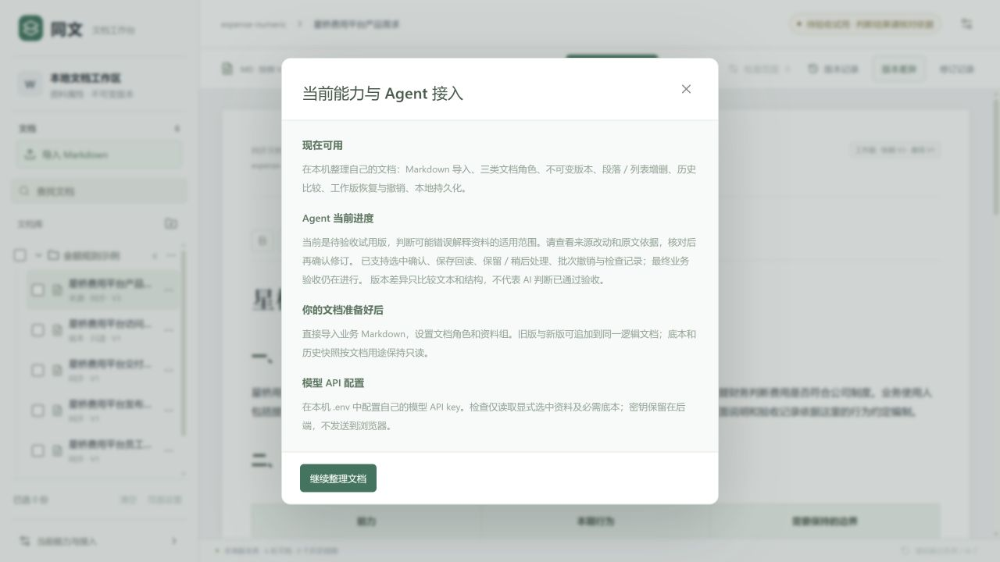

# 同文 · 个人文档工作台

同文供本人在本机整理自己的文档。修改一份资料后，选择需要核对的其他文档，查看模型给出的影响和修订依据，再逐条确认保存；可以查看版本、刷新回读和撤销。

**当前默认展示：0.26.32 金额规则示例，共6份合成文档。** 示例中财务、审批人和访问规则描述的是费用产品里的业务人物与条款；同文处理这些文本。文档的同步、底本和历史角色用于变更检查、只读快照与版本保护。

## 在本机启动

1. 安装 Node.js 24，克隆本仓库或下载 GitHub 源码。
2. 在仓库目录执行 `npm install --omit=dev --ignore-scripts`，然后执行 `npm start`。
3. 打开 http://127.0.0.1:3010/ 。第一次启动只初始化本目录的新合成资料库，随后启动保留自己的编辑和记录。

需要使用模型检查时，将 `.env.example` 复制为 `.env`，自行配置模型 API key。没有 key 时可以浏览、编辑、保存和查看版本；密钥只保存在本机后端。

## 一条演示流程

打开“星桥费用平台产品需求”，将金额表格与规则段中的5000改为3000 → 选择交付说明、发布验收、员工指引与培训重点 → 检查修改 → 展开原文与来源依据 → 分批确认正确建议 → 刷新核对全文 → 按修订批次撤销。

同版金额正常流程完成过一次真实模型与界面验证：三条必要修订分别保存，六份全文/表格刷新回读，再逐批撤销并重新刷新，**48项核对通过**。模型26次请求、96秒；来源修改保留，底本和培训重点保持，撤销后旧建议禁用。[验证记录](docs/normal-02632-ui-proof.json)。本次清理只改默认资料与界面说明，后端引擎不变，没有新增模型请求；截图记录的是当时的实际界面。

## 资料与验证边界

默认只保留金额资料组。历史识别资料里的企业共同编辑和账号访问条款属于测试输入，曾出现模型理解坏例；其移出默认演示不代表模型误判已修复，也不是同文待开发的账号协作功能。[历史测试审计](docs/audit/historical-recognition-02632.json)。

当前是个人原型，金额流程仅单次验证，重复稳定性、PDF与澄清续跑尚未完成本次完整验收。编辑、版本、确认与撤销按文档保护规则执行。

## 开发与历史

[已确认段落关系复用小样](https://github.com/julie-L0/TongWen/tree/codex/confirmed-relation-demo)位于独立分支，使用两篇单段合成资料和独立资料库。其单次对照结果与启动说明见分支 README。

`src`是React界面，`server/bootstrap.ts`是服务入口，`server/agent`是模型与工具循环，`shared`是接口类型。`dist-v2`为已构建界面。重建界面时将`package.source.json`另存为`package.json`，安装开发依赖后执行`npm run build:ui`。

[个人展示清理记录](docs/personal-scope-cleanup-proof.json)。旧版本与历史运行包保留在Git历史和`releases`目录，当前提交入口以本仓库源码和本机演示为主。
