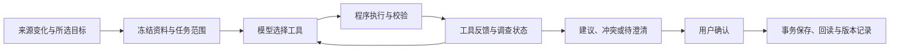

# Agent 工作原理

检查从来源的实际变化与用户选定的目标出发。模型负责解释业务和选择下一步工具，程序负责执行工具、保存证据与校验写入条件。模型给出的结论始终需要用户审阅。

## 调查循环

模型可逐轮读取上下文、描述变化、登记关联和判断、提出局部补丁、复核目标文档并结束任务。工具结果进入后续模型上下文；拒绝的调用会返回具体原因，模型可以据此调整调查。

## 证据与覆盖

来源改前／改后和目标片段带有真实文档、版本与结构块身份。提案绑定实际读取的依据；确认前检查目标是否仍可编辑、版本是否新鲜、补丁是否对应唯一原文，以及相关文档复核是否完成。

覆盖记录说明哪些来源变化和目标内容已经判断。模型自查和程序门禁帮助约束执行，但不能单独证明业务判断正确；语义结果仍需要独立验证。

## 人工确认与恢复

模型不会直接写入文档。用户确认后，程序通过事务生成新版本和修订批次，再回读结果。批次撤销检查后续版本，恢复目标内容并保留来源修改。过期建议保持可查看，其确认入口受新鲜度保护。

任务、工具轨迹、证据、文档版本与操作记录由 SQLite 持久保存。预算、取消、服务中断和迟到响应各有执行保护。

## 关系复用分支

主分支维护本次调查的关联与证据。[独立关系复用分支](https://github.com/julie-L0/TongWen/tree/codex/confirmed-relation-demo)额外保存经用户确认合并的段落关系和版本检查点。下一次修改优先检查关系是否仍有效，再用新的模型结果复核变化；旧补丁与旧判断不会直接作为新结论。

已实现的快速路径仅覆盖两篇单段文档的数值变化。长文、底本、额外目标、非数值变化或端点失效继续完整调查。

## 代码入口

| 位置 | 职责 |
| --- | --- |
| `server/agent/runtime.ts` | 模型与工具的循环执行、停止与恢复 |
| `server/agent/tools.ts` | 工具执行与反馈 |
| `server/agent/service.ts` | 任务、报告与确认入口 |
| `server/agent/review.ts` | 分批确认和撤销 |
| `server/agent/tuning/` | Prompt 资产与输入投影 |
| `server/infrastructure/sqlite-agent-store.ts` | Agent 状态持久化 |

[返回首页](../README.md) · [验证与边界](验证与边界.md)
