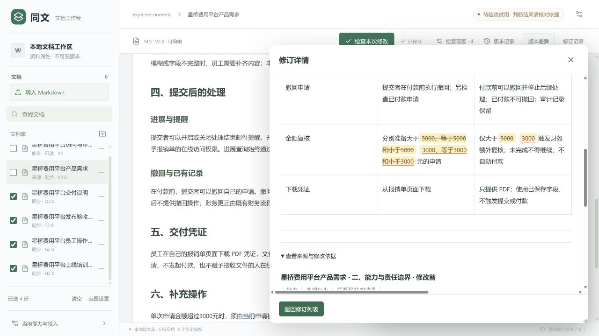

# 样例与操作

默认资料描述一个合成的费用平台，供检查文档一致性。它们是待处理业务文本；文中的财务、审批人等角色属于样例业务。

## 六份资料

| 文档 | 角色与用途 |
| --- | --- |
| 星桥费用平台产品需求 | 可编辑来源，定义本期功能与金额规则 |
| 星桥费用平台访问与审计约束 | 只读底本，提供需要遵守的约束 |
| 星桥费用平台交付说明 | 完整交付概览 |
| 星桥费用平台发布验收计划 | 功能行为与边界验收 |
| 星桥费用平台员工操作指引 | 用户实际操作说明 |
| 星桥费用平台上线培训重点 | 精选培训说明，按其用途检查 |

初始资料保存在 [`examples/expense-documents.json`](../examples/expense-documents.json)。文件按标题、角色和结构块组织，不包含评分答案或预设修订结果。

## 金额规则变更

打开产品需求，在能力表格和对应规则段落中，将四处 5000 改为 3000，保持其他条款不变。勾选交付说明、发布验收、员工指引和培训重点，点击“检查本次修改”。底本会作为必要约束核对。

查看每项建议的目标原文、修改后文本与来源依据。确认选中建议后，它们作为新版本保存；未选择的建议继续保留。刷新可核对正文与表格，修订记录提供批次撤销。

## 文档保护与恢复

底本与历史视图按用途保持只读。来源编辑、建议确认和撤销分别记录版本；撤销目标修订保留来源修改。目标后来被独立编辑时，旧建议或撤销操作可能需要重新核对，以保护新的编辑。

以上截图来自原 0.26.32 单次验收，具体用量和范围见[验证与边界](验证与边界.md)。

[返回首页](../README.md) · [快速开始](快速开始.md)
